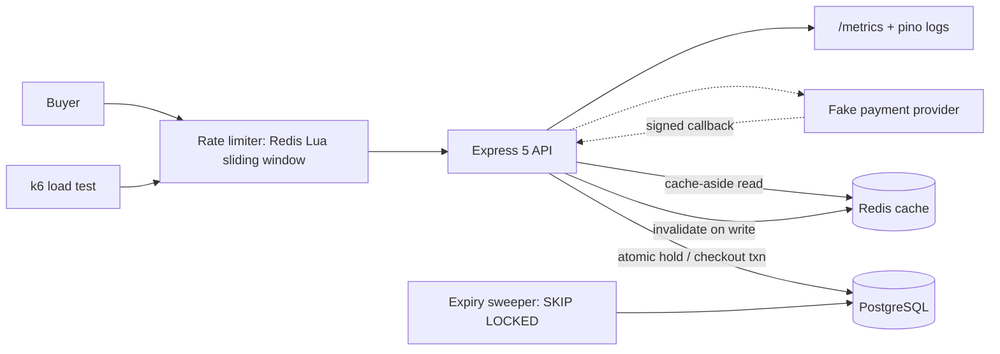

### Project 2: Seatline, a concurrency-safe ticketing API

**A. Identity.** Seatline sells numbered seats for events: browse events, hold seats for five minutes, pay, receive tickets. Target users are event organisers with flash-sale demand spikes. It adds to the portfolio by combining Postgres concurrency control with Redis used where it is safe (caching, rate limiting), and by producing a **measured result**. It differs from booking tutorials because the headline artifact is a load test showing exactly N seats sold under a much larger number of competing requests, plus a written account of where Redis must not be trusted.

**B. Technical requirements.**

| Aspect | Specification |
|---|---|
| Stack | Express 5, TypeScript, Zod, Kysely/`pg`, PostgreSQL 18, Redis 8, k6, Vitest + Testcontainers |
| Database | PostgreSQL is the source of truth for seats and orders; Redis holds only derived or disposable data |
| Schema | `users`, `events(id, name, starts_at, on_sale_at)`, `event_seats(event_id, seat_id, section, row, number, price_minor, status, held_by, held_until, version)`, `orders(id, user_id, status, total_minor, idempotency_key)`, `order_items`, `tickets` with `UNIQUE(event_id, seat_id)`, `payments` (fake provider) |
| Endpoints | `GET /events`, `GET /events/:id/seats`; `POST /events/:id/holds`; `DELETE /holds/:id`; `POST /orders` (idempotent checkout); `GET /orders/:id`; admin event CRUD |
| Redis | Cache-aside for event listing and detail (invalidate by deleting on write, TTL with jitter, protect against stampede); sliding-window rate limiter as a Lua script on `/holds` (reuses your Rbay Lua skills); optionally Pub/Sub for live seat updates. **Never** use Redis as the guard against double-selling |
| Background work | An expiry sweeper using `FOR UPDATE SKIP LOCKED`; expiry must also be correct lazily (see below) |
| Auth | JWT with roles `customer`, `organiser`; organisers manage only their events |
| Security | Rate limiting, validated input, ownership checks, fake-payment webhook signature check |
| Testing | Concurrency tests (N seats, M greater than N concurrent holders), expiry tests with a controllable clock, cache-invalidation tests, k6 scenario |
| Deployment | Compose with Redis; strong candidate for a live deployment because load results and a working demo are visible |

The hold query is an all-or-nothing atomic update: `UPDATE event_seats SET status='held', held_by=$u, held_until=now()+interval '5 minutes' WHERE event_id=$e AND seat_id = ANY($ids) AND (status='available' OR (status='held' AND held_until < now())) RETURNING seat_id`, followed by a check that the row count equals the number requested, else roll back. Because the predicate treats expired holds as available, **correctness never depends on the sweeper running**; the sweeper only cleans up and emits metrics. Checkout converts holds to tickets under `UNIQUE(event_id, seat_id)` as the last line of defence.

**Scope tiers.**

| Tier | Features |
|---|---|
| Must | Events and seats, atomic holds with expiry, idempotent checkout with fake payment, unique-ticket constraint, concurrency test, auth, Compose, CI |
| Should | Redis cache-aside with invalidation, Lua sliding-window rate limiter, k6 scenario with recorded results, `EXPLAIN`-tuned seat-map query, Prometheus `/metrics` |
| Advanced | SSE live seat map with Redis Pub/Sub fan-out across two API instances behind Caddy; virtual waiting room; optimistic `version` variant compared with the atomic-update approach; Ledgerline as payment backend |

**C. Engineering challenges.**
1. **No double-sell under contention.** Compare an atomic conditional `UPDATE`, `SELECT ... FOR UPDATE`, `SKIP LOCKED` and a unique constraint: which anomalies each prevents, and what each costs under 1,000 concurrent attempts.
2. **Hold expiry correctness.** Work out why lazy expiry in the predicate is stronger than a sweeper, and what clock the database versus application uses.
3. **Cache consistency.** Investigate stale reads after an organiser edits an event, delete-versus-update invalidation, stampede on a hot event at on-sale time, and which data may be stale (event description) versus never (seat status).
4. **Why Redis is not the lock.** Read [Kleppmann's critique](https://martin.kleppmann.com/2016/02/08/how-to-do-distributed-locking.html) (no fencing tokens, pauses and clock jumps can create two holders) and write down why seat state lives in Postgres and what a fencing token in Postgres would look like.
5. **Rate limiting.** Sliding window versus token bucket, atomicity through Lua, and behaviour when Redis is down (fail open or closed, and why).

**D. System design.**

Data flow: reads hit Redis, then Postgres on miss; writes go only to Postgres and delete cache keys; holds and checkout are single transactions. Trade-offs: cache staleness versus read load, fail-open versus fail-closed limiter, and optimistic versus atomic locking. External dependencies: Redis (disposable), a fake payment provider.

**E. Acceptance criteria.** A k6 or script test with at least 1,000 concurrent hold attempts for N seats ends with exactly N sold and zero duplicate tickets, with the results table committed; holds expire correctly even with the sweeper stopped; the same checkout key replayed yields one order; cache is invalidated on event edit (tested); rate limiter returns 429 with `Retry-After`; seat-map query plan is recorded; Compose, migrations, docs and CI are green.

**F. Interview value.** Prepares you for transactions, locking, unique constraints, caching strategies, rate limiting, load testing and Redis trade-offs. Likely questions: how do you prevent overselling; what if the sweeper dies; why not use Redis locks; how does cache invalidation fail; what is your p95 and how did you find the bottleneck. Defend by showing the benchmark, the `EXPLAIN` before/after and a test that fails when you remove the unique constraint.

**G. GitHub presentation.** Shared template, plus: hold/checkout sequence diagram, k6 results table and graph screenshot, a "what Redis does and does not do" section, and a demo with a pre-seeded event.
